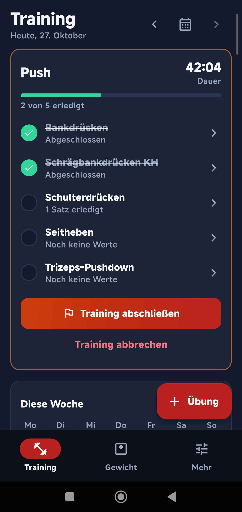
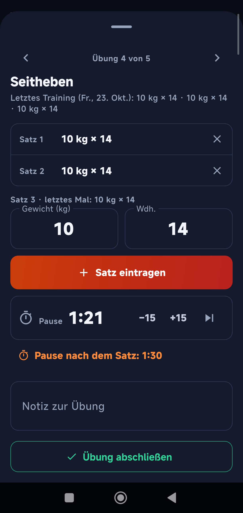
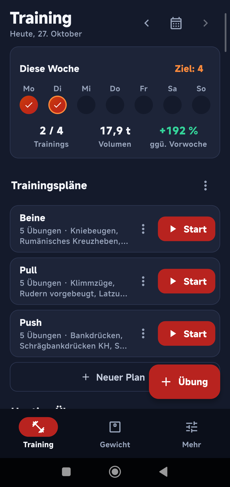
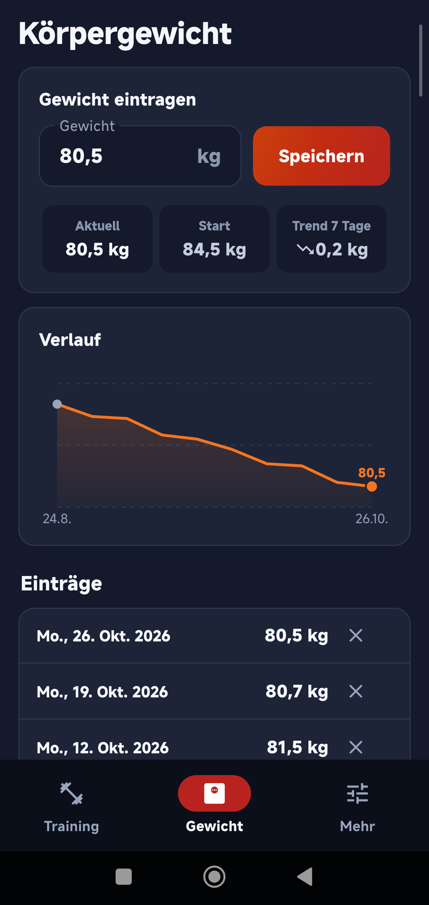

<b>English</b> · <a href="README.de.md">Deutsch</a>

<h1 align="center">IronBandit</h1>

  Free, ad-free workout log for strength training on Android. 
  Works offline, no account, all data stays on your phone.

  
  
  
  

---

## Features

- **No account, no server** – everything is stored on the device (SQLite), the app has no internet permission
- **Workout plans** like "Push Day" – only exercises and their order; start a plan and work through it exercise by exercise
- **Set by set** – log weight and reps live in the gym, prefilled from your last set and your last workout
- **Rest timer** with a notification and vibration when the rest is over, also with the app in the background (a paired watch vibrates too)
- **Week at a glance** – workouts against your weekly goal, volume compared to last week, and a hint when an exercise stalls
- **Notes per exercise** that stay with the exercise for every workout
- **Body-weight tracker** with history and 7-day trend
- **Plans as CSV** – import and export, sample file included
- **Backup & restore** as a JSON file, CSV export; the CSV export of the former IronBandit web app can be imported
- German & English, light & dark theme

## Download

Signed APKs are on the [releases page](https://github.com/CrashBandit82/ironbandit/releases)
(`arm64-v8a` fits almost every current phone).

## Build

The app lives in [`app/`](app/) – see [app/README.md](app/README.md).

## License

[GNU AGPL-3.0](LICENSE) – © CrashBandit82
